# ☕ Java Collections Framework (JCF)

<p align="center">
  
  
  
  
</p>

> Complete technical documentation of the Java Collections Framework, covering interfaces, implementation classes, internal working, hierarchy, code examples, comparisons, and practical applications.

---

# 📌 Table of Contents

1. [Introduction to Collections Framework](#1-introduction-to-collections-framework)
2. [Why Do We Need Collections?](#2-why-do-we-need-collections)
3. [Collections Framework Architecture](#3-collections-framework-architecture)
4. [Collection Interface](#4-collection-interface)
5. [List Interface](#5-list-interface)
6. [ArrayList](#6-arraylist)
7. [LinkedList](#7-linkedlist)
8. [Vector](#8-vector)
9. [Stack](#9-stack)
10. [Set Interface](#10-set-interface)
11. [HashSet](#11-hashset)
12. [LinkedHashSet](#12-linkedhashset)
13. [SortedSet and NavigableSet](#13-sortedset-and-navigableset)
14. [TreeSet](#14-treeset)
15. [Queue Interface](#15-queue-interface)
16. [PriorityQueue](#16-priorityqueue)
17. [Deque Interface](#17-deque-interface)
18. [ArrayDeque](#18-arraydeque)
19. [BlockingQueue Interface](#19-blockingqueue-interface)
20. [BlockingQueue Implementations](#20-blockingqueue-implementations)
21. [Map Interface](#21-map-interface)
22. [HashMap](#22-hashmap)
23. [LinkedHashMap](#23-linkedhashmap)
24. [TreeMap](#24-treemap)
25. [Hashtable](#25-hashtable)
26. [ConcurrentHashMap](#26-concurrenthashmap)
27. [Properties](#27-properties)
28. [Iterator and ListIterator](#28-iterator-and-listiterator)
29. [Comparable and Comparator](#29-comparable-and-comparator)
30. [Collections Utility Class](#30-collections-utility-class)
31. [Important Comparisons](#31-important-comparisons)
32. [Time Complexity](#32-time-complexity)
33. [Practical Project](#33-practical-project)
34. [Best Practices](#34-best-practices)
35. [Practice Programs](#35-practice-programs)

---

# 1. Introduction to Collections Framework

## What is the Java Collections Framework?

The Java Collections Framework (JCF) is a collection of interfaces, classes, and algorithms used to store, manage, retrieve, and manipulate groups of objects.

It belongs mainly to the `java.util` package.

Instead of creating multiple variables to store different values, we can use collections to store and manage multiple objects together.

### Example: Without Collections

```java
public class Main {

    public static void main(String[] args) {

        int a = 10;
        int b = 20;
        int c = 30;
        int d = 40;

        System.out.println(a);
        System.out.println(b);
        System.out.println(c);
        System.out.println(d);
    }
}
```

Here, we need separate variables for each value.

### Example: Using Collections

```java
import java.util.ArrayList;

public class Main {

    public static void main(String[] args) {

        ArrayList<Integer> numbers = new ArrayList<>();

        numbers.add(10);
        numbers.add(20);
        numbers.add(30);
        numbers.add(40);

        System.out.println(numbers);
    }
}
```

**Output:**

```text
[10, 20, 30, 40]
```

We can store multiple elements in a single collection object.

## Important Features

| Feature | Description |
|---|---|
| Dynamic Size | Collections can grow or shrink dynamically |
| Ready-made Classes | Provides implementations such as ArrayList and HashSet |
| Generics | Provides type safety |
| Searching | Provides methods for searching elements |
| Sorting | Supports sorting |
| Insertion and Deletion | Supports adding and removing elements |
| Reusability | Provides reusable data structures |
| Algorithms | Provides searching, sorting, reversing, etc. |

---

# 2. Why Do We Need Collections?

Before Collections, Java developers often used arrays to store multiple values.

However, arrays have some limitations.

## Limitations of Arrays

1. Fixed size.
2. Insertion and deletion require manual shifting.
3. Limited built-in operations.
4. Cannot directly grow or shrink.
5. Searching and sorting often require additional logic.

### Example: Array

```java
public class Main {

    public static void main(String[] args) {

        int[] arr = new int[3];

        arr[0] = 10;
        arr[1] = 20;
        arr[2] = 30;

        System.out.println(arr[0]);
    }
}
```

The array size is fixed at 3.

### Example: ArrayList

```java
import java.util.ArrayList;

public class Main {

    public static void main(String[] args) {

        ArrayList<Integer> list = new ArrayList<>();

        list.add(10);
        list.add(20);
        list.add(30);
        list.add(40);

        System.out.println(list);
    }
}
```

ArrayList can dynamically increase its capacity when more elements are added.

## Array vs Collection

| Array | Collection |
|---|---|
| Fixed size | Dynamic size |
| Can store primitives and objects | Stores objects (use wrapper classes for primitives) |
| Limited built-in methods | Provides many ready-made methods |
| No direct Collection Framework hierarchy | Part of the Collections Framework |
| Can be multidimensional | Can contain nested collections |

**Important:** Java Collections generally store objects, not primitive types.

For example:

```java
ArrayList<Integer> list = new ArrayList<>();
```

Here, `Integer` is the wrapper class of `int`.

---

# 3. Collections Framework Architecture

The Java Collections Framework mainly consists of:

1. Interfaces
2. Implementation Classes
3. Algorithms

## Complete Collections Framework Hierarchy

The following diagram shows the major interfaces and implementation classes.

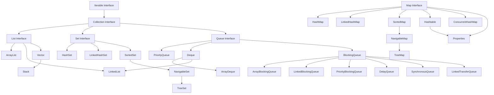

**Important:** Map is not a child of the Collection interface. It is a separate part of the Collections Framework.

Also, `LinkedList` implements both List and Deque, so it appears in two places in the hierarchy.

## Main Interfaces

| Interface | Purpose |
|---|---|
| List | Stores ordered elements and allows duplicates |
| Set | Stores unique elements |
| Queue | Stores elements for processing |
| Deque | Supports insertion and removal at both ends |
| Map | Stores key-value pairs |

## Main Implementation Classes

| Interface | Implementation Classes |
|---|---|
| List | ArrayList, LinkedList, Vector, Stack |
| Set | HashSet, LinkedHashSet, TreeSet |
| Queue | PriorityQueue, LinkedList |
| Deque | ArrayDeque, LinkedList |
| BlockingQueue | ArrayBlockingQueue, LinkedBlockingQueue, PriorityBlockingQueue |
| Map | HashMap, LinkedHashMap, TreeMap, Hashtable |

---

# 4. Collection Interface

The Collection interface is the root interface of the main collection hierarchy.

It provides common methods used by List, Set, and Queue.

**Package:**

```java
import java.util.Collection;
```

## Important Methods

| Method | Description |
|---|---|
| add() | Adds an element |
| addAll() | Adds all elements of another collection |
| remove() | Removes an element |
| removeAll() | Removes matching elements |
| retainAll() | Keeps only common elements |
| clear() | Removes all elements |
| contains() | Checks whether an element exists |
| containsAll() | Checks whether all elements exist |
| size() | Returns the number of elements |
| isEmpty() | Checks whether the collection is empty |
| iterator() | Returns an iterator |
| toArray() | Converts collection into an array |

## Example

```java
import java.util.Collection;
import java.util.ArrayList;

public class Main {

    public static void main(String[] args) {

        Collection<String> names = new ArrayList<>();

        names.add("Rahul");
        names.add("Aman");
        names.add("Priya");

        System.out.println(names);

        System.out.println(names.size());

        System.out.println(names.contains("Rahul"));

        names.remove("Aman");

        System.out.println(names);

    }
}
```

**Output:**

```text
[Rahul, Aman, Priya]
3
true
[Rahul, Priya]
```

**Remember:** Collection is an interface. We cannot directly create its object.

```java
Collection<String> list = new ArrayList<>();
```

This is valid because ArrayList implements Collection through List.

---

# 5. List Interface

## What is List?

List is an interface that stores elements in an ordered sequence.

It allows duplicate elements and provides index-based access.

**Package:**

```java
import java.util.List;
```

## Features of List

1. Maintains insertion order.
2. Allows duplicate elements.
3. Supports index-based access.
4. Allows multiple null values in common implementations such as ArrayList and LinkedList.
5. Provides methods for insertion, deletion, and updating.

## List Hierarchy

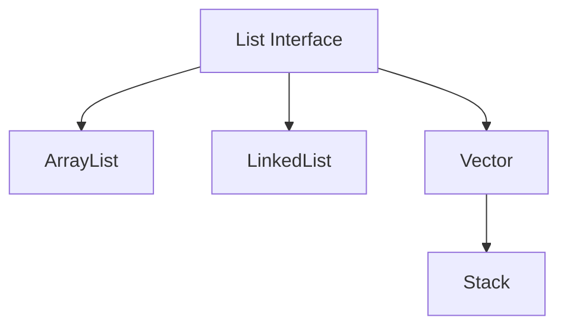

## Important Methods

| Method | Description |
|---|---|
| add() | Adds an element |
| add(index, element) | Adds at a specific index |
| get(index) | Retrieves an element |
| set(index, element) | Replaces an element |
| remove(index) | Removes by index |
| indexOf() | Returns first occurrence index |
| lastIndexOf() | Returns last occurrence index |
| subList() | Returns a view of a range |
| listIterator() | Returns a ListIterator |

## Example

```java
import java.util.List;
import java.util.ArrayList;

public class Main {

    public static void main(String[] args) {

        List<String> names = new ArrayList<>();

        names.add("Rahul");
        names.add("Aman");
        names.add("Priya");
        names.add("Rahul");

        System.out.println(names);

        System.out.println(names.get(1));

        names.set(1, "Rohit");

        System.out.println(names);

        names.remove(0);

        System.out.println(names);
    }
}
```

**Output:**

```text
[Rahul, Aman, Priya, Rahul]
Aman
[Rahul, Rohit, Priya, Rahul]
[Rohit, Priya, Rahul]
```

---

# 6. ArrayList

## What is ArrayList?

ArrayList is a resizable array implementation of the List interface.

It dynamically grows when elements are added and can shrink when elements are removed.

It belongs to `java.util`.

### Internal Working

ArrayList internally uses a dynamically resizable array.

When the current internal array cannot accommodate another element, ArrayList allocates a larger array and copies the existing elements.

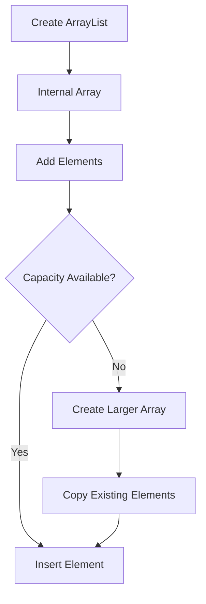

## Features

- Maintains insertion order.
- Allows duplicates.
- Allows null values.
- Provides fast index-based access.
- Not synchronized by default.
- Insertion in the middle may require shifting elements.

## Syntax

```java
ArrayList<Integer> list = new ArrayList<>();
```

## Example

```java
import java.util.ArrayList;

public class Main {

    public static void main(String[] args) {

        ArrayList<Integer> numbers = new ArrayList<>();

        numbers.add(10);
        numbers.add(20);
        numbers.add(30);

        System.out.println(numbers);

        System.out.println(numbers.get(1));

        numbers.add(1, 15);

        System.out.println(numbers);

        numbers.remove(Integer.valueOf(20));

        System.out.println(numbers);
    }
}
```

**Output:**

```text
[10, 20, 30]
20
[10, 15, 20, 30]
[10, 15, 30]
```

## Important Methods

| Method | Purpose |
|---|---|
| add() | Adds elements |
| get() | Retrieves element |
| set() | Updates element |
| remove() | Removes element |
| size() | Returns size |
| contains() | Checks element |
| indexOf() | Finds first index |
| clear() | Removes all elements |
| ensureCapacity() | Ensures minimum capacity |
| trimToSize() | Reduces capacity to current size |

## ArrayList Capacity

ArrayList has two important concepts:

- Size: Number of elements currently stored.
- Capacity: Length of its internal array.

Example:

```java
ArrayList<Integer> list = new ArrayList<>(10);
```

Here, the initial capacity is 10, but the size is 0.

```java
System.out.println(list.size());
```

Output:

```text
0
```

**Important:** The exact growth policy is an implementation detail. Do not depend on a fixed growth factor in application code.

## When to Use ArrayList?

Use ArrayList when:

- Frequent searching by index is required.
- Frequent retrieval is required.
- Insertion and deletion mostly happen at the end.
- Maintaining insertion order is important.

---

# 7. LinkedList

## What is LinkedList?

LinkedList is a doubly linked list implementation of the List and Deque interfaces.

Unlike ArrayList, it does not use a continuous internal array.

Instead, it stores elements in nodes.

Each node contains:

1. Previous node reference.
2. Element data.
3. Next node reference.

## Internal Structure

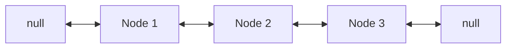

### Node Structure

```text
+----------+----------+----------+
| Previous |  Data    | Next     |
+----------+----------+----------+
```

## Features

- Maintains insertion order.
- Allows duplicates.
- Allows null values.
- Implements List and Deque.
- Supports insertion and deletion at both ends.
- Does not provide constant-time index-based access.
- Not synchronized by default.

## Example

```java
import java.util.LinkedList;

public class Main {

    public static void main(String[] args) {

        LinkedList<String> names = new LinkedList<>();

        names.add("Rahul");
        names.add("Aman");
        names.add("Priya");

        names.addFirst("Rohit");

        names.addLast("Neha");

        System.out.println(names);

        names.removeFirst();

        names.removeLast();

        System.out.println(names);
    }
}
```

**Output:**

```text
[Rohit, Rahul, Aman, Priya, Neha]
[Rahul, Aman, Priya]
```

## Important Methods

| Method | Purpose |
|---|---|
| addFirst() | Adds at beginning |
| addLast() | Adds at end |
| getFirst() | Retrieves first element |
| getLast() | Retrieves last element |
| removeFirst() | Removes first element |
| removeLast() | Removes last element |
| offerFirst() | Inserts at beginning |
| offerLast() | Inserts at end |
| peekFirst() | Retrieves first without removal |
| peekLast() | Retrieves last without removal |

## When to Use LinkedList?

- When frequent insertions and deletions at the beginning or end are needed.
- When implementing a deque.
- When queue operations are required.

**Important:** LinkedList is not automatically faster than ArrayList for insertions and deletions. Finding the position in a linked list can itself take O(n) time.

---

# 8. Vector

## What is Vector?

Vector is a legacy synchronized implementation of the List interface.

It behaves similarly to ArrayList but its methods are synchronized.

It was introduced before the modern Collections Framework.

## Features

- Maintains insertion order.
- Allows duplicates.
- Allows null values.
- Dynamically grows.
- Synchronized methods.
- Usually slower than ArrayList in single-threaded operations due to synchronization overhead.

## Internal Working

Vector uses a dynamically resizable array.

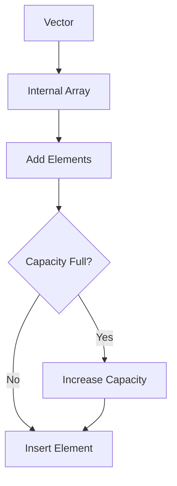

## Example

```java
import java.util.Vector;

public class Main {

    public static void main(String[] args) {

        Vector<String> names = new Vector<>();

        names.add("Rahul");
        names.add("Aman");
        names.add("Priya");

        System.out.println(names);

        System.out.println(names.capacity());

        names.remove("Aman");

        System.out.println(names);
    }
}
```

**Output:**

```text
[Rahul, Aman, Priya]
10
[Rahul, Priya]
```

The default initial capacity of Vector is 10.

## Important Methods

| Method | Description |
|---|---|
| add() | Adds elements |
| addElement() | Adds an element |
| capacity() | Returns current capacity |
| elementAt() | Retrieves element |
| firstElement() | Returns first element |
| lastElement() | Returns last element |
| removeElement() | Removes an element |
| removeAllElements() | Removes all elements |

## ArrayList vs Vector

| ArrayList | Vector |
|---|---|
| Not synchronized | Synchronized methods |
| Introduced with Collections Framework | Legacy class |
| Faster in typical single-threaded use | Synchronization adds overhead |
| Grows according to implementation policy | Default capacity increment is doubling when no custom increment is configured |
| Modern general-purpose choice | Legacy synchronized list |

---

# 9. Stack

## What is Stack?

Stack is a legacy class that extends Vector.

It follows the LIFO principle.

LIFO means Last In, First Out.

The element inserted last is removed first.

## Stack Working

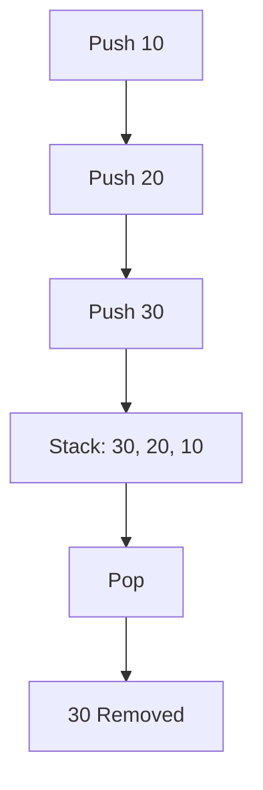

## Real-Life Examples

- Stack of plates.
- Undo operation.
- Browser history.
- Function call stack.
- Expression evaluation.

## Important Methods

| Method | Description |
|---|---|
| push() | Adds an element |
| pop() | Removes and returns top element |
| peek() | Returns top element without removing |
| empty() | Checks whether stack is empty |
| search() | Searches an element |

## Example

```java
import java.util.Stack;

public class Main {

    public static void main(String[] args) {

        Stack<Integer> stack = new Stack<>();

        stack.push(10);
        stack.push(20);
        stack.push(30);

        System.out.println(stack);

        System.out.println(stack.peek());

        System.out.println(stack.pop());

        System.out.println(stack);

        System.out.println(stack.empty());
    }
}
```

**Output:**

```text
[10, 20, 30]
30
30
[10, 20]
false
```

## Important Point

Stack extends Vector.

Therefore, Stack inherits methods that are not strictly stack operations.

For new applications, `ArrayDeque` is generally preferred for stack operations.

### Stack Using ArrayDeque

```java
import java.util.ArrayDeque;
import java.util.Deque;

public class Main {

    public static void main(String[] args) {

        Deque<Integer> stack = new ArrayDeque<>();

        stack.push(10);
        stack.push(20);
        stack.push(30);

        System.out.println(stack.pop());

        System.out.println(stack.peek());
    }
}
```

**Output:**

```text
30
20
```

---

# 10. Set Interface

## What is Set?

Set is an interface that stores unique elements.

It does not allow duplicate elements according to the equality rules of its implementation.

## Features

- Does not allow duplicates.
- Does not provide index-based access.
- Different implementations maintain different ordering.
- Supports mathematical set operations.

## Set Hierarchy

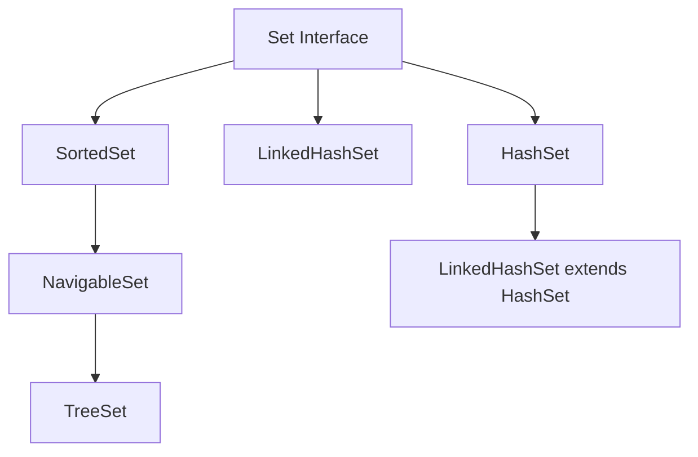

## Important Methods

| Method | Description |
|---|---|
| add() | Adds an element |
| remove() | Removes an element |
| contains() | Checks element |
| size() | Returns number of elements |
| isEmpty() | Checks whether empty |
| clear() | Removes all elements |
| addAll() | Adds another collection |
| retainAll() | Keeps common elements |
| removeAll() | Removes matching elements |

## Example

```java
import java.util.Set;
import java.util.HashSet;

public class Main {

    public static void main(String[] args) {

        Set<Integer> numbers = new HashSet<>();

        numbers.add(10);
        numbers.add(20);
        numbers.add(30);
        numbers.add(10);

        System.out.println(numbers);

        System.out.println(numbers.size());
    }
}
```

**Possible Output:**

```text
[20, 10, 30]
3
```

The order is not guaranteed.

---

# 11. HashSet

## What is HashSet?

HashSet is an implementation of the Set interface.

It stores unique elements using a hash table.

## Internal Working

HashSet internally uses a HashMap to store its elements.

The elements are stored as keys in the internal HashMap, with a shared dummy object as the value.

### Internal Structure

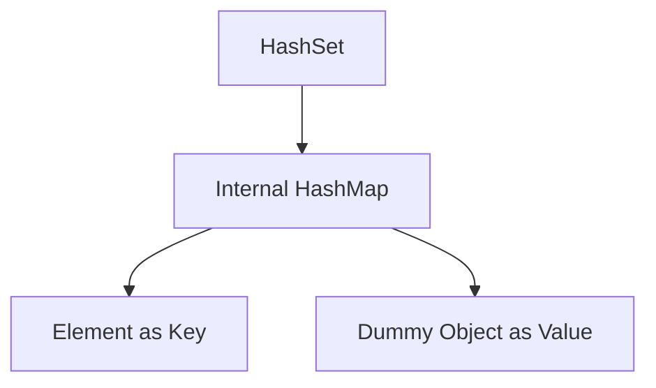

## Features

- Does not allow duplicates.
- Does not guarantee insertion order.
- Allows one null element.
- Provides average O(1) basic operations when hashes are well distributed.
- Not synchronized.

## Example

```java
import java.util.HashSet;

public class Main {

    public static void main(String[] args) {

        HashSet<String> names = new HashSet<>();

        names.add("Rahul");
        names.add("Aman");
        names.add("Priya");
        names.add("Rahul");

        System.out.println(names);

        System.out.println(names.contains("Aman"));

        names.remove("Aman");

        System.out.println(names);
    }
}
```

**Possible Output:**

```text
[Priya, Rahul, Aman]
true
[Priya, Rahul]
```

## Important Methods

| Method | Purpose |
|---|---|
| add() | Adds an element |
| remove() | Removes an element |
| contains() | Checks element |
| size() | Returns size |
| clear() | Removes all elements |

## Why Are Duplicates Not Allowed?

HashSet uses `hashCode()` and `equals()` to determine whether two objects represent equal elements.

If two objects are equal according to `equals()`, HashSet treats them as duplicates.

### Important: equals() and hashCode()

When storing custom objects in HashSet, correctly override both methods.

Example:

```java
import java.util.*;

class Student {

    int id;

    Student(int id) {
        this.id = id;
    }

    @Override
    public boolean equals(Object obj) {

        if (this == obj) return true;

        if (!(obj instanceof Student)) return false;

        Student s = (Student) obj;

        return id == s.id;
    }

    @Override
    public int hashCode() {
        return Integer.hashCode(id);
    }
}

public class Main {

    public static void main(String[] args) {

        Set<Student> students = new HashSet<>();

        students.add(new Student(101));
        students.add(new Student(101));

        System.out.println(students.size());
    }
}
```

**Output:**

```text
1
```

---

# 12. LinkedHashSet

## What is LinkedHashSet?

LinkedHashSet is an implementation of Set that maintains insertion order.

It extends HashSet and uses a linked structure to maintain iteration order.

## Features

- Does not allow duplicates.
- Maintains insertion order.
- Allows one null element.
- Uses hashing for efficient lookup.
- Not synchronized.

## Example

```java
import java.util.LinkedHashSet;

public class Main {

    public static void main(String[] args) {

        LinkedHashSet<String> names = new LinkedHashSet<>();

        names.add("Rahul");
        names.add("Aman");
        names.add("Priya");
        names.add("Rahul");

        System.out.println(names);
    }
}
```

**Output:**

```text
[Rahul, Aman, Priya]
```

## HashSet vs LinkedHashSet

| HashSet | LinkedHashSet |
|---|---|
| No guaranteed iteration order | Maintains insertion order |
| Hash table | Hash table with linked ordering |
| Allows one null | Allows one null |
| Generally lower ordering overhead | Additional memory for ordering |

---

# 13. SortedSet and NavigableSet

## 13.1 SortedSet

SortedSet is an interface that maintains elements in sorted order.

It supports natural ordering or a supplied Comparator.

### Important Methods

| Method | Description |
|---|---|
| first() | Returns smallest element |
| last() | Returns largest element |
| headSet() | Returns elements smaller than a given value |
| tailSet() | Returns elements greater than or equal to a given value |
| subSet() | Returns a specified range |
| comparator() | Returns the comparator |

## 13.2 NavigableSet

NavigableSet extends SortedSet.

It provides navigation methods to find nearby elements.

### Important Methods

| Method | Description |
|---|---|
| lower() | Greatest element strictly less than the given value |
| floor() | Greatest element less than or equal to the given value |
| ceiling() | Smallest element greater than or equal to the given value |
| higher() | Smallest element strictly greater than the given value |
| pollFirst() | Retrieves and removes first element |
| pollLast() | Retrieves and removes last element |
| descendingSet() | Returns reverse-order view |

## Hierarchy

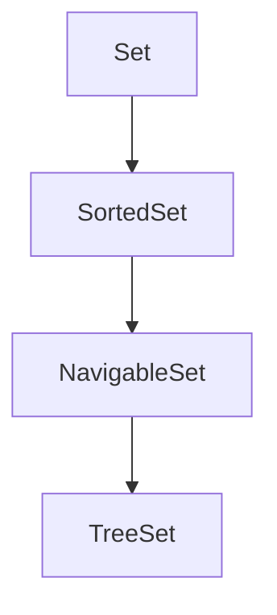

---

# 14. TreeSet

## What is TreeSet?

TreeSet is an implementation of NavigableSet.

It stores unique elements in sorted order.

Internally, it uses a balanced tree structure, specifically a Red-Black tree through its backing TreeMap implementation.

## Features

- Does not allow duplicates.
- Maintains sorted order.
- Does not allow null elements in its natural-order configuration.
- Provides efficient search, insertion, and deletion.
- Not synchronized.

## Internal Working

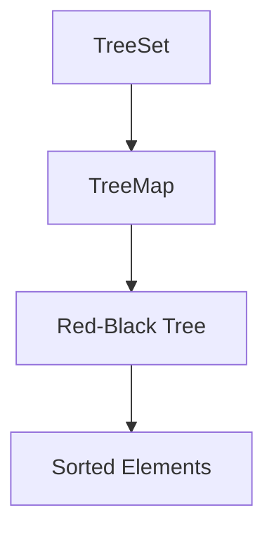

## Example

```java
import java.util.TreeSet;

public class Main {

    public static void main(String[] args) {

        TreeSet<Integer> numbers = new TreeSet<>();

        numbers.add(40);
        numbers.add(10);
        numbers.add(30);
        numbers.add(20);

        System.out.println(numbers);

        System.out.println(numbers.first());

        System.out.println(numbers.last());
    }
}
```

**Output:**

```text
[10, 20, 30, 40]
10
40
```

## Navigation Example

```java
import java.util.TreeSet;

public class Main {

    public static void main(String[] args) {

        TreeSet<Integer> numbers = new TreeSet<>();

        numbers.add(10);
        numbers.add(20);
        numbers.add(30);
        numbers.add(40);

        System.out.println(numbers.lower(30));

        System.out.println(numbers.floor(30));

        System.out.println(numbers.ceiling(25));

        System.out.println(numbers.higher(30));
    }
}
```

**Output:**

```text
20
30
30
40
```

## HashSet vs LinkedHashSet vs TreeSet

| Feature | HashSet | LinkedHashSet | TreeSet |
|---|---|---|---|
| Duplicates | Not allowed | Not allowed | Not allowed |
| Order | No guarantee | Insertion order | Sorted order |
| Internal structure | Hash table | Hash table + linked ordering | Red-Black tree |
| Null | One null | One null | No null in natural ordering |
| Average/basic operations | O(1) | O(1) | O(log n) |
| Synchronization | No | No | No |

---

# 15. Queue Interface

## What is Queue?

Queue is an interface used to store elements before processing them.

The standard queue principle is FIFO.

FIFO means First In, First Out.

The element inserted first is generally removed first.

## Real-Life Examples

- Ticket booking line.
- Printer queue.
- Customer service queue.
- Task scheduling.

## Queue Hierarchy

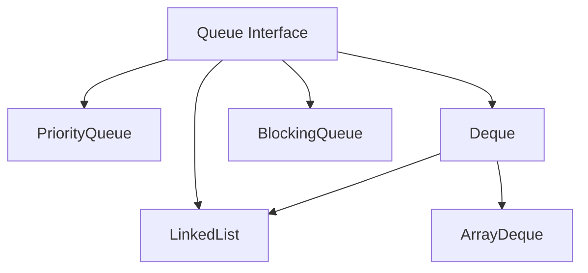

## Important Queue Methods

| Method | Description |
|---|---|
| add() | Inserts an element; may throw an exception |
| offer() | Inserts an element; returns false if insertion fails |
| remove() | Removes the head; throws an exception if empty |
| poll() | Removes the head; returns null if empty |
| element() | Retrieves the head; throws an exception if empty |
| peek() | Retrieves the head; returns null if empty |

## add() vs offer()

| add() | offer() |
|---|---|
| Inserts an element | Inserts an element |
| May throw an exception if insertion fails | Returns false if insertion fails |
| Common for ordinary queues | Useful for capacity-restricted queues |

## remove() vs poll()

| remove() | poll() |
|---|---|
| Removes head element | Removes head element |
| Throws exception if empty | Returns null if empty |

## element() vs peek()

| element() | peek() |
|---|---|
| Retrieves head | Retrieves head |
| Throws exception if empty | Returns null if empty |
| Does not remove element | Does not remove element |

## Example

```java
import java.util.Queue;
import java.util.LinkedList;

public class Main {

    public static void main(String[] args) {

        Queue<Integer> queue = new LinkedList<>();

        queue.add(10);
        queue.add(20);
        queue.add(30);

        System.out.println(queue);

        System.out.println(queue.peek());

        System.out.println(queue.poll());

        System.out.println(queue);
    }
}
```

**Output:**

```text
[10, 20, 30]
10
10
[20, 30]
```

---

# 16. PriorityQueue

## What is PriorityQueue?

PriorityQueue is an implementation of the Queue interface.

Unlike an ordinary FIFO queue, elements are processed according to their priority.

By default, it uses natural ordering, so the smallest element has the highest priority.

## Internal Working

PriorityQueue internally uses a binary heap.

The default implementation is a min-heap.

### Min-Heap Example

```text
             10
           /    \
         20      30
        /  \
       40  50
```

The smallest element is available at the root.

## Features

- Processes elements according to priority.
- Does not guarantee FIFO ordering.
- Allows duplicate elements.
- Does not allow null.
- Not synchronized.
- Uses a binary heap internally.

## Example

```java
import java.util.PriorityQueue;

public class Main {

    public static void main(String[] args) {

        PriorityQueue<Integer> pq = new PriorityQueue<>();

        pq.add(40);
        pq.add(10);
        pq.add(30);
        pq.add(20);

        System.out.println(pq.peek());

        while (!pq.isEmpty()) {

            System.out.println(pq.poll());

        }
    }
}
```

**Output:**

```text
10
10
20
30
40
```

**Important:** Printing a PriorityQueue directly does not guarantee sorted output. Repeatedly calling poll() retrieves elements in priority order.

## Max-Heap

We can create a max-heap using a Comparator.

```java
import java.util.PriorityQueue;
import java.util.Collections;

public class Main {

    public static void main(String[] args) {

        PriorityQueue<Integer> pq =
            new PriorityQueue<>(Collections.reverseOrder());

        pq.add(10);
        pq.add(40);
        pq.add(20);
        pq.add(30);

        while (!pq.isEmpty()) {

            System.out.println(pq.poll());

        }
    }
}
```

**Output:**

```text
40
30
20
10
```

---

# 17. Deque Interface

## What is Deque?

Deque stands for Double Ended Queue.

It allows insertion and deletion at both ends.

It can work as:

- A Queue (FIFO).
- A Stack (LIFO).

## Deque Hierarchy

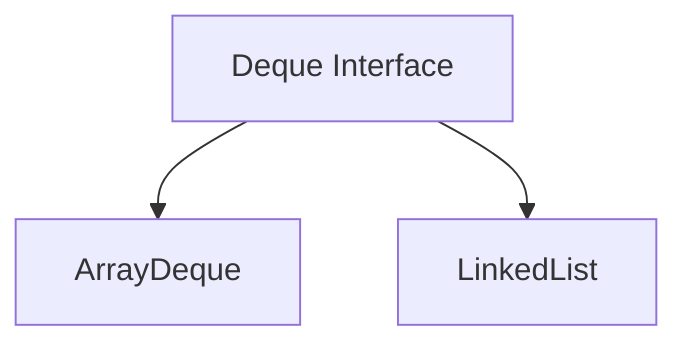

## Important Methods

| Operation | First End | Last End |
|---|---|---|
| Insert | addFirst() | addLast() |
| Offer | offerFirst() | offerLast() |
| Remove | removeFirst() | removeLast() |
| Poll | pollFirst() | pollLast() |
| Retrieve | getFirst() | getLast() |
| Peek | peekFirst() | peekLast() |

## Example

```java
import java.util.ArrayDeque;
import java.util.Deque;

public class Main {

    public static void main(String[] args) {

        Deque<Integer> deque = new ArrayDeque<>();

        deque.addFirst(10);
        deque.addLast(20);
        deque.addFirst(5);

        System.out.println(deque);

        deque.removeFirst();

        deque.removeLast();

        System.out.println(deque);
    }
}
```

**Output:**

```text
[5, 10, 20]
[10]
```

---

# 18. ArrayDeque

## What is ArrayDeque?

ArrayDeque is a resizable-array implementation of the Deque interface.

It supports insertion and removal at both ends.

## Features

- Allows insertion and deletion at both ends.
- Does not allow null elements.
- Not synchronized.
- Can be used as a stack or queue.
- Generally offers amortized O(1) operations at both ends.

## Example: Queue Using ArrayDeque

```java
import java.util.ArrayDeque;
import java.util.Queue;

public class Main {

    public static void main(String[] args) {

        Queue<Integer> queue = new ArrayDeque<>();

        queue.offer(10);
        queue.offer(20);
        queue.offer(30);

        System.out.println(queue.poll());

        System.out.println(queue);
    }
}
```

**Output:**

```text
10
[20, 30]
```

## Example: Stack Using ArrayDeque

```java
import java.util.ArrayDeque;
import java.util.Deque;

public class Main {

    public static void main(String[] args) {

        Deque<Integer> stack = new ArrayDeque<>();

        stack.push(10);
        stack.push(20);
        stack.push(30);

        System.out.println(stack.pop());

        System.out.println(stack.peek());
    }
}
```

**Output:**

```text
30
20
```

## ArrayDeque vs LinkedList

| ArrayDeque | LinkedList |
|---|---|
| Resizable array | Doubly linked list |
| Does not allow null | Allows null |
| Generally more memory-efficient | Extra memory for node links |
| Efficient at both ends | Efficient at both ends |
| Implements Deque | Implements List and Deque |

---

# 19. BlockingQueue Interface

## What is BlockingQueue?

BlockingQueue is an interface that extends Queue.

It is designed for thread-safe communication between multiple threads.

It is commonly used in producer-consumer applications.

### Why Do We Need BlockingQueue?

Suppose one thread produces data and another thread consumes data.

Problems can occur:

- Consumer tries to retrieve data when the queue is empty.
- Producer tries to insert data when the queue is full.

BlockingQueue handles these situations by allowing certain operations to wait.

## Producer-Consumer Architecture

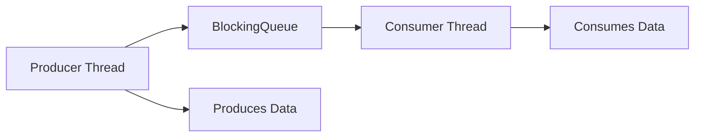

## Four Types of BlockingQueue Operations

| Operation Type | Insert | Remove | Inspect |
|---|---|---|---|
| Throws exception | add() | remove() | element() |
| Returns special value | offer() | poll() | peek() |
| Blocks | put() | take() | Not applicable |
| Times out | offer(e, time, unit) | poll(time, unit) | Not applicable |

### Important Methods

| Method | Description |
|---|---|
| put() | Inserts and waits if full |
| take() | Removes and waits if empty |
| offer() | Attempts insertion |
| poll() | Attempts removal |
| remainingCapacity() | Returns estimated remaining capacity |

---

# 20. BlockingQueue Implementations

There are several implementations of BlockingQueue.

## Complete Hierarchy

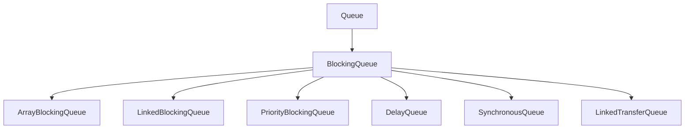

## 20.1 ArrayBlockingQueue

### What is ArrayBlockingQueue?

ArrayBlockingQueue is a bounded blocking queue backed by a fixed-size array.

Bounded means it has a fixed capacity.

### Features

- Fixed capacity.
- Thread-safe.
- FIFO ordering.
- Blocks when full during put().
- Blocks when empty during take().
- Does not allow null elements.

### Example

```java
import java.util.concurrent.ArrayBlockingQueue;

public class Main {

    public static void main(String[] args) throws InterruptedException {

        ArrayBlockingQueue<Integer> queue =
            new ArrayBlockingQueue<>(3);

        queue.put(10);
        queue.put(20);
        queue.put(30);

        System.out.println(queue);

        System.out.println(queue.take());

        System.out.println(queue);
    }
}
```

**Output:**

```text
[10, 20, 30]
10
[20, 30]
```

### Important Point

If the queue already contains three elements:

```java
ArrayBlockingQueue<Integer> queue =
    new ArrayBlockingQueue<>(3);
```

Calling:

```java
queue.put(40);
```

will wait until space becomes available.

## 20.2 LinkedBlockingQueue

### What is LinkedBlockingQueue?

LinkedBlockingQueue is a blocking queue backed by linked nodes.

It can be bounded or effectively unbounded.

When created without a specified capacity, its theoretical capacity is `Integer.MAX_VALUE`.

### Features

- Linked-node implementation.
- Thread-safe.
- FIFO ordering.
- Optional capacity limit.
- Blocks during put() if full.
- Blocks during take() if empty.
- Does not allow null elements.

### Example

```java
import java.util.concurrent.LinkedBlockingQueue;

public class Main {

    public static void main(String[] args) throws InterruptedException {

        LinkedBlockingQueue<Integer> queue =
            new LinkedBlockingQueue<>(3);

        queue.put(10);
        queue.put(20);
        queue.put(30);

        System.out.println(queue);

        System.out.println(queue.take());
    }
}
```

**Output:**

```text
[10, 20, 30]
10
```

## 20.3 PriorityBlockingQueue

### What is PriorityBlockingQueue?

PriorityBlockingQueue is a thread-safe priority queue.

Elements are processed according to priority rather than insertion order.

By default, the smallest element is processed first.

### Features

- Thread-safe.
- Priority-based ordering.
- Unbounded in capacity.
- Does not allow null elements.
- Does not block producers due to capacity restrictions.
- Consumer operations can block when empty using take().

### Example

```java
import java.util.concurrent.PriorityBlockingQueue;

public class Main {

    public static void main(String[] args) {

        PriorityBlockingQueue<Integer> queue =
            new PriorityBlockingQueue<>();

        queue.add(40);
        queue.add(10);
        queue.add(30);
        queue.add(20);

        while (!queue.isEmpty()) {

            System.out.println(queue.poll());

        }
    }
}
```

**Output:**

```text
10
20
30
40
```

## 20.4 DelayQueue

### What is DelayQueue?

DelayQueue is an unbounded blocking queue that stores elements implementing the Delayed interface.

An element can be retrieved only after its delay has expired.

### Features

- Thread-safe.
- Elements become available after their delay.
- Does not allow null elements.
- Elements must implement Delayed.
- Useful for scheduling and expiration tasks.

### Example

```java
import java.util.concurrent.*;

class MyTask implements Delayed {

    private final long expiry;

    MyTask(long delay) {

        expiry = System.currentTimeMillis() + delay;

    }

    @Override
    public long getDelay(TimeUnit unit) {

        long remaining = expiry - System.currentTimeMillis();

        return unit.convert(remaining, TimeUnit.MILLISECONDS);

    }

    @Override
    public int compareTo(Delayed other) {

        return Long.compare(
            getDelay(TimeUnit.MILLISECONDS),
            other.getDelay(TimeUnit.MILLISECONDS)
        );
    }
}

public class Main {

    public static void main(String[] args) throws InterruptedException {

        DelayQueue<MyTask> queue = new DelayQueue<>();

        queue.put(new MyTask(2000));

        System.out.println("Waiting for delay...");

        queue.take();

        System.out.println("Task available");
    }
}
```

**Output:**

```text
Waiting for delay...
Task available
```

## 20.5 SynchronousQueue

### What is SynchronousQueue?

SynchronousQueue is a special blocking queue that does not have internal storage capacity.

Every insertion must wait for a corresponding removal by another thread, and vice versa.

It works as a direct handoff mechanism.

### Features

- No internal storage capacity.
- Thread-safe.
- Direct producer-consumer handoff.
- put() waits for a consumer.
- take() waits for a producer.

### Example

```java
import java.util.concurrent.SynchronousQueue;

public class Main {

    public static void main(String[] args) throws InterruptedException {

        SynchronousQueue<Integer> queue =
            new SynchronousQueue<>();

        Thread producer = new Thread(() -> {

            try {

                queue.put(100);

                System.out.println("Data transferred");

            } catch (InterruptedException e) {

                Thread.currentThread().interrupt();

            }
        });

        Thread consumer = new Thread(() -> {

            try {

                System.out.println("Received: " + queue.take());

            } catch (InterruptedException e) {

                Thread.currentThread().interrupt();

            }
        });

        consumer.start();

        producer.start();

        producer.join();
        consumer.join();
    }
}
```

**Output:**

```text
Received: 100
Data transferred
```

The exact print order can depend on thread scheduling.

## 20.6 LinkedTransferQueue

### What is LinkedTransferQueue?

LinkedTransferQueue is an unbounded transfer queue that supports producer-consumer communication.

It implements the TransferQueue interface, which extends BlockingQueue.

It provides a special `transfer()` method.

### Important Methods

| Method | Description |
|---|---|
| transfer() | Transfers an element and waits until it is received |
| tryTransfer() | Attempts immediate transfer |
| tryTransfer(e, time, unit) | Attempts transfer with a timeout |
| hasWaitingConsumer() | Checks whether a consumer is waiting |
| getWaitingConsumerCount() | Returns an estimate of waiting consumers |

### Example

```java
import java.util.concurrent.LinkedTransferQueue;

public class Main {

    public static void main(String[] args) throws InterruptedException {

        LinkedTransferQueue<Integer> queue =
            new LinkedTransferQueue<>();

        Thread consumer = new Thread(() -> {

            try {

                System.out.println("Received: " + queue.take());

            } catch (InterruptedException e) {

                Thread.currentThread().interrupt();

            }
        });

        consumer.start();

        queue.transfer(100);

        consumer.join();
    }
}
```

**Output:**

```text
Received: 100
```

## BlockingQueue Implementations Comparison

| Implementation | Internal Structure | Capacity | Ordering |
|---|---|---|---|
| ArrayBlockingQueue | Array | Fixed | FIFO |
| LinkedBlockingQueue | Linked nodes | Optional bounded capacity | FIFO |
| PriorityBlockingQueue | Binary heap | Unbounded | Priority |
| DelayQueue | Priority-based structure | Unbounded | Delay expiration |
| SynchronousQueue | No storage | Zero | Direct handoff |
| LinkedTransferQueue | Linked structure | Unbounded | Transfer-based |

---

# 21. Map Interface

## What is Map?

Map is an interface that stores data in key-value pairs.

Each key maps to one value.

Unlike List and Set, Map does not extend the Collection interface.

### Example

```text
101 → Rahul
102 → Aman
103 → Priya
```

Here:

- 101 is a key.
- Rahul is a value.

## Features

- Stores key-value pairs.
- Keys must be unique.
- Values can be duplicated.
- Values can be retrieved using keys.
- Different implementations provide different ordering and thread-safety characteristics.

## Map Hierarchy

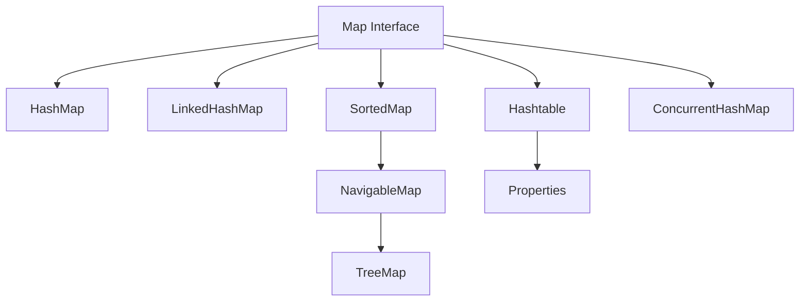

**Important:** Map is separate from Collection.

## Important Methods

| Method | Description |
|---|---|
| put() | Adds key-value pair |
| get() | Retrieves value using key |
| remove() | Removes entry |
| containsKey() | Checks key |
| containsValue() | Checks value |
| keySet() | Returns all keys |
| values() | Returns all values |
| entrySet() | Returns all key-value entries |
| putAll() | Copies another map |
| putIfAbsent() | Inserts if key is absent |
| getOrDefault() | Returns default value if key is absent |
| replace() | Replaces a value |
| clear() | Removes all entries |

## Example

```java
import java.util.Map;
import java.util.HashMap;

public class Main {

    public static void main(String[] args) {

        Map<Integer, String> students = new HashMap<>();

        students.put(101, "Rahul");
        students.put(102, "Aman");
        students.put(103, "Priya");

        System.out.println(students);

        System.out.println(students.get(101));

        System.out.println(students.containsKey(102));

        students.remove(102);

        System.out.println(students);
    }
}
```

**Possible Output:**

```text
{101=Rahul, 102=Aman, 103=Priya}
Rahul
true
{101=Rahul, 103=Priya}
```

---

# 22. HashMap

## What is HashMap?

HashMap is an implementation of the Map interface.

It stores key-value pairs using hashing.

## Features

- Does not guarantee iteration order.
- Allows one null key.
- Allows multiple null values.
- Keys must be unique.
- Not synchronized.
- Provides average O(1) basic lookup and insertion under suitable hash distribution.

## Internal Working

HashMap internally uses a hash table.

The hash code of a key helps determine the bucket in which an entry is stored.

### Internal Structure

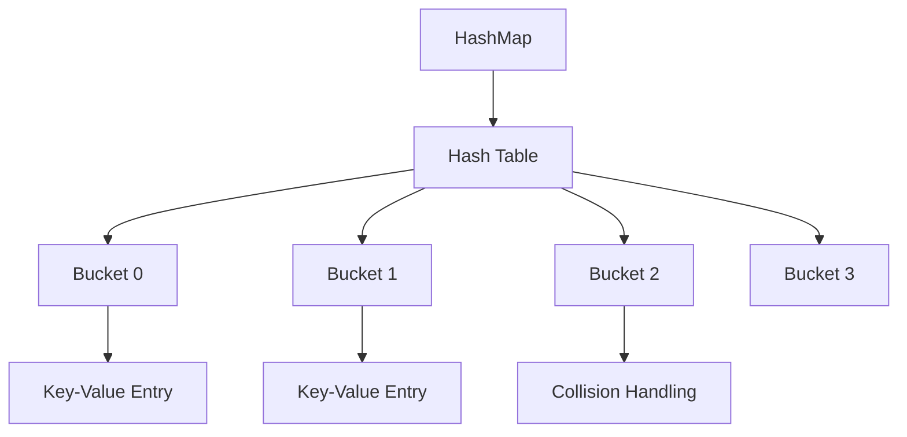

### How HashMap Works

1. We insert a key-value pair using put().
2. HashMap calculates a hash from the key.
3. The hash helps determine a bucket index.
4. The entry is stored in that bucket.
5. When retrieving data, the hash helps locate the bucket.
6. equals() is used to identify the matching key.

### What is Hash Collision?

A hash collision occurs when different keys map to the same bucket.

Java HashMap handles collisions using linked structures and may use balanced tree structures for heavily populated buckets under certain conditions.

## Example

```java
import java.util.HashMap;

public class Main {

    public static void main(String[] args) {

        HashMap<Integer, String> map = new HashMap<>();

        map.put(101, "Rahul");
        map.put(102, "Aman");
        map.put(103, "Priya");

        System.out.println(map.get(101));

        map.put(101, "Rohit");

        System.out.println(map);
    }
}
```

**Possible Output:**

```text
Rahul
{101=Rohit, 102=Aman, 103=Priya}
```

When an existing key is inserted again, its associated value is replaced.

## Important Methods

| Method | Purpose |
|---|---|
| put() | Inserts entry |
| get() | Retrieves value |
| remove() | Removes entry |
| containsKey() | Checks key |
| containsValue() | Checks value |
| keySet() | Returns keys |
| values() | Returns values |
| entrySet() | Returns entries |

## Iterating Through HashMap

```java
import java.util.HashMap;
import java.util.Map;

public class Main {

    public static void main(String[] args) {

        HashMap<Integer, String> map = new HashMap<>();

        map.put(101, "Rahul");
        map.put(102, "Aman");
        map.put(103, "Priya");

        for (Map.Entry<Integer, String> entry : map.entrySet()) {

            System.out.println(
                entry.getKey() + " : " + entry.getValue()
            );
        }
    }
}
```

---

# 23. LinkedHashMap

## What is LinkedHashMap?

LinkedHashMap is an implementation of HashMap that maintains a defined iteration order.

By default, it maintains insertion order.

It can also be configured for access-order iteration.

## Features

- Maintains insertion order by default.
- Allows one null key.
- Allows multiple null values.
- Uses hashing and linked ordering.
- Not synchronized.

## Example

```java
import java.util.LinkedHashMap;

public class Main {

    public static void main(String[] args) {

        LinkedHashMap<Integer, String> map =
            new LinkedHashMap<>();

        map.put(101, "Rahul");
        map.put(102, "Aman");
        map.put(103, "Priya");

        System.out.println(map);
    }
}
```

**Output:**

```text
{101=Rahul, 102=Aman, 103=Priya}
```

## HashMap vs LinkedHashMap

| HashMap | LinkedHashMap |
|---|---|
| No guaranteed iteration order | Maintains insertion order by default |
| Uses hash table | Uses hash table and linked ordering |
| Allows one null key | Allows one null key |
| Generally lower memory overhead | Additional memory for ordering |

---

# 24. TreeMap

## What is TreeMap?

TreeMap is an implementation of NavigableMap.

It stores key-value pairs in sorted key order.

Internally, it uses a Red-Black tree.

## Features

- Maintains sorted key order.
- Does not allow null keys in natural-order configuration.
- Allows null values.
- Keys must be comparable or use a Comparator.
- Not synchronized.
- Basic operations take O(log n) time.

## Internal Working

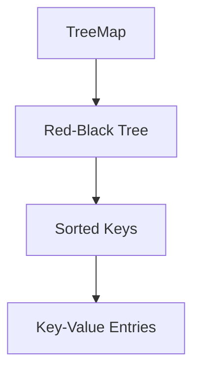

## Example

```java
import java.util.TreeMap;

public class Main {

    public static void main(String[] args) {

        TreeMap<Integer, String> map = new TreeMap<>();

        map.put(103, "Priya");
        map.put(101, "Rahul");
        map.put(102, "Aman");

        System.out.println(map);

        System.out.println(map.firstKey());

        System.out.println(map.lastKey());
    }
}
```

**Output:**

```text
{101=Rahul, 102=Aman, 103=Priya}
101
103
```

## Important Methods

| Method | Description |
|---|---|
| firstKey() | Returns smallest key |
| lastKey() | Returns largest key |
| lowerKey() | Greatest key strictly less than given key |
| floorKey() | Greatest key less than or equal to given key |
| ceilingKey() | Smallest key greater than or equal to given key |
| higherKey() | Smallest key strictly greater than given key |
| pollFirstEntry() | Retrieves and removes first entry |
| pollLastEntry() | Retrieves and removes last entry |

---

# 25. Hashtable

## What is Hashtable?

Hashtable is a legacy synchronized implementation of Map.

It stores key-value pairs using hashing.

## Features

- Synchronized methods.
- Does not allow null keys.
- Does not allow null values.
- Does not guarantee iteration order.
- Legacy class.
- Usually not the preferred choice for new concurrent applications.

## Example

```java
import java.util.Hashtable;

public class Main {

    public static void main(String[] args) {

        Hashtable<Integer, String> table = new Hashtable<>();

        table.put(101, "Rahul");
        table.put(102, "Aman");
        table.put(103, "Priya");

        System.out.println(table);

        System.out.println(table.get(101));
    }
}
```

**Possible Output:**

```text
{103=Priya, 102=Aman, 101=Rahul}
Rahul
```

## HashMap vs Hashtable

| HashMap | Hashtable |
|---|---|
| Not synchronized | Synchronized methods |
| Allows one null key | Does not allow null key |
| Allows null values | Does not allow null values |
| Modern general-purpose Map | Legacy Map |
| Usually preferred in single-threaded use | Usually avoided in new applications |

---

# 26. ConcurrentHashMap

## What is ConcurrentHashMap?

ConcurrentHashMap is a thread-safe implementation of Map designed for concurrent access by multiple threads.

It belongs to `java.util.concurrent`.

## Why Do We Need It?

Suppose multiple threads are accessing and modifying the same map.

A normal HashMap does not provide thread-safe concurrent modification.

ConcurrentHashMap is designed to handle concurrent access safely.

## Features

- Thread-safe.
- Supports concurrent reads and updates.
- Does not allow null keys.
- Does not allow null values.
- Does not guarantee iteration order.
- Provides atomic methods such as putIfAbsent() and compute().

## Example

```java
import java.util.concurrent.ConcurrentHashMap;

public class Main {

    public static void main(String[] args) {

        ConcurrentHashMap<Integer, String> map =
            new ConcurrentHashMap<>();

        map.put(101, "Rahul");
        map.put(102, "Aman");

        map.putIfAbsent(103, "Priya");

        System.out.println(map);
    }
}
```

**Possible Output:**

```text
{101=Rahul, 102=Aman, 103=Priya}
```

## HashMap vs ConcurrentHashMap

| HashMap | ConcurrentHashMap |
|---|---|
| Not thread-safe | Thread-safe |
| Allows null key | Does not allow null key |
| Allows null values | Does not allow null values |
| No concurrent access guarantees | Supports concurrent access |
| Suitable for ordinary non-concurrent use | Suitable for concurrent applications |

---

# 27. Properties

## What is Properties?

Properties is a legacy class that extends Hashtable.

It is used to store configuration data as key-value pairs, usually represented as strings.

It is commonly used for application configuration files.

## Features

- Stores key-value pairs.
- Commonly uses String keys and values.
- Extends Hashtable.
- Synchronized inherited operations.
- Supports loading and saving `.properties` files.

## Example

```java
import java.util.Properties;

public class Main {

    public static void main(String[] args) {

        Properties properties = new Properties();

        properties.setProperty("username", "Rahul");

        properties.setProperty("password", "12345");

        System.out.println(
            properties.getProperty("username")
        );

        System.out.println(
            properties.getProperty("password")
        );
    }
}
```

**Output:**

```text
Rahul
12345
```

## Important Methods

| Method | Description |
|---|---|
| setProperty() | Stores a string property |
| getProperty() | Retrieves a property |
| load() | Loads properties from a stream or reader |
| store() | Saves properties |
| propertyNames() | Returns property names |
| stringPropertyNames() | Returns property names as a Set |

## Real-World Example: Configuration File

`config.properties`

```properties
username=admin
database=student_db
port=3306
```

### Reading Properties File

```java
import java.io.FileInputStream;
import java.io.IOException;
import java.util.Properties;

public class Main {

    public static void main(String[] args) {

        Properties properties = new Properties();

        try (FileInputStream fis =
                new FileInputStream("config.properties")) {

            properties.load(fis);

            System.out.println(
                properties.getProperty("username")
            );

            System.out.println(
                properties.getProperty("database")
            );

        } catch (IOException e) {

            e.printStackTrace();

        }
    }
}
```

---

# 28. Iterator and ListIterator

## What is Iterator?

Iterator is an interface used to traverse elements of a collection one by one.

It belongs to `java.util`.

### Important Methods

| Method | Description |
|---|---|
| hasNext() | Checks whether another element exists |
| next() | Returns next element |
| remove() | Removes the last returned element, if supported |

## Example

```java
import java.util.ArrayList;
import java.util.Iterator;

public class Main {

    public static void main(String[] args) {

        ArrayList<String> names = new ArrayList<>();

        names.add("Rahul");
        names.add("Aman");
        names.add("Priya");

        Iterator<String> itr = names.iterator();

        while (itr.hasNext()) {

            System.out.println(itr.next());

        }
    }
}
```

**Output:**

```text
Rahul
Aman
Priya
```

## What is ListIterator?

ListIterator is an iterator specifically for List implementations.

It supports forward and backward traversal.

### Important Methods

| Method | Description |
|---|---|
| hasNext() | Checks next element |
| next() | Returns next element |
| hasPrevious() | Checks previous element |
| previous() | Returns previous element |
| add() | Inserts an element |
| set() | Replaces last returned element |
| remove() | Removes last returned element |

## Example

```java
import java.util.ArrayList;
import java.util.ListIterator;

public class Main {

    public static void main(String[] args) {

        ArrayList<Integer> list = new ArrayList<>();

        list.add(10);
        list.add(20);
        list.add(30);

        ListIterator<Integer> itr = list.listIterator();

        System.out.println("Forward:");

        while (itr.hasNext()) {

            System.out.println(itr.next());

        }

        System.out.println("Backward:");

        while (itr.hasPrevious()) {

            System.out.println(itr.previous());

        }
    }
}
```

**Output:**

```text
Forward:
10
20
30

Backward:
30
20
10
```

## Iterator vs ListIterator

| Iterator | ListIterator |
|---|---|
| Works with collections | Works with List |
| Forward traversal | Forward and backward traversal |
| hasNext() | hasNext(), hasPrevious() |
| next() | next(), previous() |
| Supports removal | Supports addition, replacement, and removal |

---

# 29. Comparable and Comparator

These interfaces are used to define sorting logic.

## 29.1 Comparable

Comparable is used to define the natural ordering of objects.

It belongs to `java.lang`.

It contains:

```java
compareTo()
```

### Example

```java
import java.util.*;

class Student implements Comparable<Student> {

    int marks;

    Student(int marks) {
        this.marks = marks;
    }

    @Override
    public int compareTo(Student s) {

        return Integer.compare(this.marks, s.marks);

    }
}

public class Main {

    public static void main(String[] args) {

        List<Student> students = new ArrayList<>();

        students.add(new Student(80));
        students.add(new Student(60));
        students.add(new Student(90));

        Collections.sort(students);

        for (Student s : students) {

            System.out.println(s.marks);

        }
    }
}
```

**Output:**

```text
60
80
90
```

## 29.2 Comparator

Comparator is used to define custom sorting logic.

It belongs to `java.util`.

Important method:

```java
compare()
```

### Example

```java
import java.util.*;

class Student {

    int marks;

    Student(int marks) {
        this.marks = marks;
    }
}

public class Main {

    public static void main(String[] args) {

        List<Student> students = new ArrayList<>();

        students.add(new Student(80));
        students.add(new Student(60));
        students.add(new Student(90));

        Comparator<Student> comp =
            (s1, s2) -> Integer.compare(s2.marks, s1.marks);

        students.sort(comp);

        for (Student s : students) {

            System.out.println(s.marks);

        }
    }
}
```

**Output:**

```text
90
80
60
```

## Comparable vs Comparator

| Comparable | Comparator |
|---|---|
| Defines natural ordering | Defines custom ordering |
| java.lang | java.util |
| compareTo() | compare() |
| Implemented by the class being sorted | Can be implemented separately |
| Generally one natural ordering | Multiple sorting strategies possible |

---

# 30. Collections Utility Class

## What is Collections?

Collections is a utility class in `java.util`.

It provides static methods to perform operations on collections.

**Important:** Collections is a class, whereas Collection is an interface.

## Important Methods

| Method | Description |
|---|---|
| sort() | Sorts a list |
| reverse() | Reverses a list |
| shuffle() | Randomly rearranges elements |
| min() | Returns smallest element |
| max() | Returns largest element |
| frequency() | Counts occurrences |
| binarySearch() | Searches a sorted list |
| swap() | Swaps two elements |
| fill() | Replaces list elements with a specified value |
| copy() | Copies elements into a destination list |
| unmodifiableList() | Returns an unmodifiable view |
| synchronizedList() | Returns a synchronized view |

## Example

```java
import java.util.*;

public class Main {

    public static void main(String[] args) {

        ArrayList<Integer> list =
            new ArrayList<>(Arrays.asList(40, 10, 30, 20));

        Collections.sort(list);

        System.out.println("Sorted: " + list);

        Collections.reverse(list);

        System.out.println("Reversed: " + list);

        System.out.println("Minimum: " +
                Collections.min(list));

        System.out.println("Maximum: " +
                Collections.max(list));

        System.out.println("Frequency: " +
                Collections.frequency(list, 20));
    }
}
```

**Output:**

```text
Sorted: [10, 20, 30, 40]
Reversed: [40, 30, 20, 10]
Minimum: 10
Maximum: 40
Frequency: 1
```

---

# 31. Important Comparisons

## List vs Set vs Queue vs Map

| Feature | List | Set | Queue | Map |
|---|---|---|---|---|
| Stores | Elements | Unique elements | Elements for processing | Key-value pairs |
| Duplicates | Allowed | Not allowed | Depends on implementation | Keys are unique |
| Ordering | Defined by implementation; List maintains sequence | Depends on implementation | Depends on implementation | Depends on implementation |
| Index access | Yes | No | No | By key |
| Examples | ArrayList | HashSet | PriorityQueue | HashMap |

## ArrayList vs LinkedList

| Feature | ArrayList | LinkedList |
|---|---|---|
| Internal structure | Dynamic array | Doubly linked list |
| Random access | O(1) | O(n) |
| Add at end | Amortized O(1) | O(1) |
| Add at beginning | O(n) | O(1) |
| Memory | Generally lower overhead | Extra memory for links |
| Implements | List | List and Deque |

## HashSet vs TreeSet

| Feature | HashSet | TreeSet |
|---|---|---|
| Order | No guarantee | Sorted |
| Internal structure | Hash table | Red-Black tree |
| Performance | Average O(1) | O(log n) |
| Duplicates | Not allowed | Not allowed |
| Null | One null | No null in natural ordering |

## HashMap vs TreeMap

| Feature | HashMap | TreeMap |
|---|---|---|
| Ordering | No guarantee | Sorted keys |
| Internal structure | Hash table | Red-Black tree |
| Performance | Average O(1) | O(log n) |
| Null key | One null | Not in natural ordering |
| Null values | Allowed | Allowed |

## Queue vs Deque

| Queue | Deque |
|---|---|
| Usually processes elements from the head | Supports both ends |
| Typically FIFO | Can act as FIFO or LIFO |
| offer(), poll(), peek() | offerFirst(), offerLast(), pollFirst(), pollLast() |

## ArrayBlockingQueue vs LinkedBlockingQueue

| ArrayBlockingQueue | LinkedBlockingQueue |
|---|---|
| Array-based | Linked-node-based |
| Fixed capacity | Optional bounded capacity |
| FIFO | FIFO |
| Thread-safe | Thread-safe |
| Preallocates array | Allocates nodes as elements are inserted |

---

# 32. Time Complexity

The following are typical complexities for common implementations.

| Operation | ArrayList | LinkedList | HashSet | TreeSet | HashMap |
|---|---:|---:|---:|---:|---:|
| Add at end | Amortized O(1) | O(1) | Average O(1) | O(log n) | Average O(1) |
| Search | O(n) | O(n) | Average O(1) | O(log n) | Average O(1) |
| Get by index | O(1) | O(n) | Not supported | Not supported | Not supported |
| Remove by value | O(n) | O(n) | Average O(1) | O(log n) | Average O(1) |

**Note:** Hash-based complexity depends on hash distribution and implementation details. These are average-case expectations, not unconditional guarantees.

---

# 33. Practical Project: Student Management System

Let's create a simple student management program using Java Collections.

### Project Requirements

- Store student records.
- Add new students.
- Search student details using ID.
- Remove student records.
- Display all students.

### Concepts Used

| Concept | Implementation |
|---|---|
| Map | HashMap |
| Key | Student ID |
| Value | Student Name |
| Add | put() |
| Search | get() |
| Delete | remove() |
| Display | entrySet() |

### Complete Code

```java
import java.util.HashMap;
import java.util.Map;
import java.util.Scanner;

public class StudentManagement {

    public static void main(String[] args) {

        Scanner sc = new Scanner(System.in);

        HashMap<Integer, String> students = new HashMap<>();

        while (true) {

            System.out.println("\n===== STUDENT MANAGEMENT =====");

            System.out.println("1. Add Student");

            System.out.println("2. Search Student");

            System.out.println("3. Remove Student");

            System.out.println("4. Display Students");

            System.out.println("5. Exit");

            System.out.print("Enter choice: ");

            int choice = sc.nextInt();

            switch (choice) {

                case 1:

                    System.out.print("Enter ID: ");

                    int id = sc.nextInt();

                    sc.nextLine();

                    System.out.print("Enter Name: ");

                    String name = sc.nextLine();

                    students.put(id, name);

                    System.out.println("Student added");

                    break;

                case 2:

                    System.out.print("Enter ID: ");

                    int searchId = sc.nextInt();

                    if (students.containsKey(searchId)) {

                        System.out.println(
                            students.get(searchId)
                        );

                    } else {

                        System.out.println("Student not found");

                    }

                    break;

                case 3:

                    System.out.print("Enter ID: ");

                    int removeId = sc.nextInt();

                    if (students.containsKey(removeId)) {

                        students.remove(removeId);

                        System.out.println("Student removed");

                    } else {

                        System.out.println("Student not found");

                    }

                    break;

                case 4:

                    System.out.println("\nStudent Records:");

                    for (Map.Entry<Integer, String> entry :
                            students.entrySet()) {

                        System.out.println(
                            entry.getKey() + " : " +
                            entry.getValue()
                        );

                    }

                    break;

                case 5:

                    System.out.println("Exiting application");

                    sc.close();

                    return;

                default:

                    System.out.println("Invalid choice");

            }
        }
    }
}
```

### Sample Output

```text
===== STUDENT MANAGEMENT =====
1. Add Student
2. Search Student
3. Remove Student
4. Display Students
5. Exit

Enter choice: 1
Enter ID: 101
Enter Name: Rahul
Student added

Enter choice: 4

Student Records:
101 : Rahul
```

---

# 34. Best Practices

1. Use generics to ensure type safety.
2. Prefer ArrayList for general-purpose list operations.
3. Use HashSet when duplicate elements are not required.
4. Use LinkedHashSet when insertion order matters.
5. Use TreeSet when sorted unique elements are required.
6. Use HashMap for general-purpose key-value storage.
7. Use LinkedHashMap when iteration order matters.
8. Use TreeMap when sorted keys are required.
9. Prefer ArrayDeque over legacy Stack for stack operations.
10. Use BlockingQueue for producer-consumer communication.
11. Use ConcurrentHashMap for concurrent map operations.
12. Avoid modifying a collection structurally while iterating over it, except through supported iterator operations.
13. Use Comparable or Comparator for custom sorting.
14. Choose data structures according to access patterns and performance requirements.

---

# 35. Practice Programs

## Beginner Level

- [ ] Create an ArrayList of integers.
- [ ] Add and remove elements.
- [ ] Find an element in ArrayList.
- [ ] Remove duplicates using HashSet.
- [ ] Create a LinkedHashSet.
- [ ] Sort elements using TreeSet.
- [ ] Create a HashMap of student records.
- [ ] Retrieve a value using a key.
- [ ] Iterate through a collection using Iterator.
- [ ] Reverse a list using Collections.

## Intermediate Level

- [ ] Sort students using Comparable.
- [ ] Sort students using Comparator.
- [ ] Implement a stack using ArrayDeque.
- [ ] Implement a queue using LinkedList.
- [ ] Implement a priority queue.
- [ ] Implement a deque.
- [ ] Count word frequencies using HashMap.
- [ ] Find duplicate elements in an ArrayList.
- [ ] Merge two lists.
- [ ] Sort a HashMap by keys using TreeMap.

## Advanced Level

- [ ] Implement producer-consumer using ArrayBlockingQueue.
- [ ] Implement producer-consumer using LinkedBlockingQueue.
- [ ] Create a task scheduler using PriorityQueue.
- [ ] Implement a thread-safe counter using ConcurrentHashMap.
- [ ] Create an employee management system using HashMap.
- [ ] Implement an LRU cache using LinkedHashMap.
- [ ] Implement a custom sorting system using Comparator.
- [ ] Build a student record management application.

---

# 📚 Final Revision Cheat Sheet

## Collection Hierarchy

| Interface | Important Implementations |
|---|---|
| List | ArrayList, LinkedList, Vector |
| Vector | Stack |
| Set | HashSet, LinkedHashSet |
| SortedSet | TreeSet |
| NavigableSet | TreeSet |
| Queue | LinkedList, PriorityQueue |
| Deque | ArrayDeque, LinkedList |
| BlockingQueue | ArrayBlockingQueue, LinkedBlockingQueue, PriorityBlockingQueue, DelayQueue, SynchronousQueue, LinkedTransferQueue |

## Map Hierarchy

| Interface | Important Implementations |
|---|---|
| Map | HashMap, LinkedHashMap, Hashtable, ConcurrentHashMap |
| Hashtable | Properties |
| SortedMap | TreeMap |
| NavigableMap | TreeMap |

## Important Concepts

- List allows duplicates and maintains sequence.
- Set does not allow duplicate elements.
- HashSet uses hashing.
- LinkedHashSet maintains insertion order.
- TreeSet maintains sorted order.
- ArrayList uses a dynamic array.
- LinkedList uses a doubly linked list.
- Vector is synchronized.
- Stack follows LIFO.
- Queue generally follows FIFO.
- PriorityQueue processes elements according to priority.
- Deque supports both ends.
- BlockingQueue supports blocking producer-consumer operations.
- HashMap stores key-value pairs.
- LinkedHashMap maintains insertion order by default.
- TreeMap maintains sorted keys.
- Hashtable is synchronized and does not allow null keys or values.
- ConcurrentHashMap supports concurrent access.
- Iterator supports forward traversal.
- ListIterator supports forward and backward traversal.
- Comparable defines natural ordering.
- Comparator defines custom ordering.
- Collections is a utility class.
- Collection is an interface.

---

<p align="center">

## 🎯 END OF JAVA COLLECTIONS FRAMEWORK NOTES

**Understand → Implement → Practice → Master**

*Java Collections Framework | Core Java Documentation*

</p>
